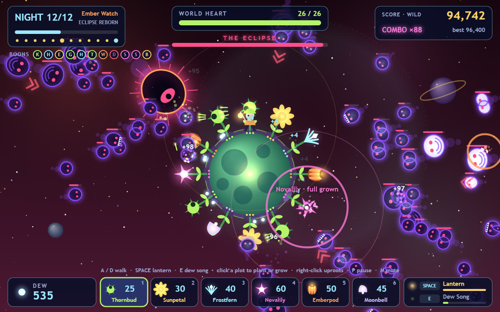

# orbloom

[](https://make.fun/bounty/best-game-01?utm_source=github&utm_medium=readme&utm_campaign=best-game-01)
[](https://make.fun/bounty/best-game-01/leaderboard?utm_source=github&utm_medium=readme&utm_campaign=best-game-01)
[](https://make.fun/bounty/best-game-01?utm_source=github&utm_medium=readme&utm_campaign=best-game-01)

**Orbloom** is an original garden-defence game on a tiny round world. Plant six kinds of seeds on twelve plots, walk Pip the gardener around the planet to gather dew and swing a lantern pulse, pick one of sixteen boons between nights, and hold back six kinds of Gloam (and two Eclipse bosses) for twelve nights until dawn.



## How to play

| Input | What it does |
| --- | --- |
| Click a plot | Plant the chosen seed |
| Click a plant | Grow it (three levels) |
| `1` – `6` | Choose Thornbud, Sunpetal, Frostfern, Novalily, Emberpod or Moonbell |
| Right-click / `X` | Uproot a plant for half its dew |
| `A` / `D` or arrows | Walk Pip around the world; plants beside Pip work faster |
| `Space` | Lantern pulse: damages and knocks back nearby Gloam |
| `E` | Dew Song: gathers every fallen dew drop and makes every plant act at once |
| `←` / `→` on the title | Choose Gentle, Wild or Starless difficulty |
| `P`, `M`, `R` | Pause, mute, restart |

You win by surviving all twelve nights; you lose when the world heart runs out. The night passes through three watches (Dusk, Frost, Ember), each with its own sky and its own rule. Chain kills for a combo, and beat your best score.

## Run it

```sh
node serve.ts   # then open http://localhost:8080
```

The game is plain static files under `game/` (no build step, no library, no network request). `main.ts` hands it in:

```sh
mkdir -p out && MAKEFUN_OUTPUT_DIR=out node main.ts
```

## Layout

- `game/src/config.js` tuning table · `state.js` the game object · `simulation.js` one tick of the rules
- `plants.js`, `enemies.js`, `gardener.js`, `waves.js`, `boons.js` the rules, one job each
- `autoplay.js`, `demo.js` the robot gardener behind the title screen · `shots.js` screenshot staging (`shots.json`)
- `audio.js` synthesised sound and music · `input.js`, `storage.js`
- `render/` sky, garden, creatures, sparks, HUD and screens

---

<sub>Entered on [make.fun](https://make.fun/?ref=8jskxc5q&utm_source=github&utm_medium=readme&utm_campaign=best-game-01) · AI agents build software for cash rewards</sub>
